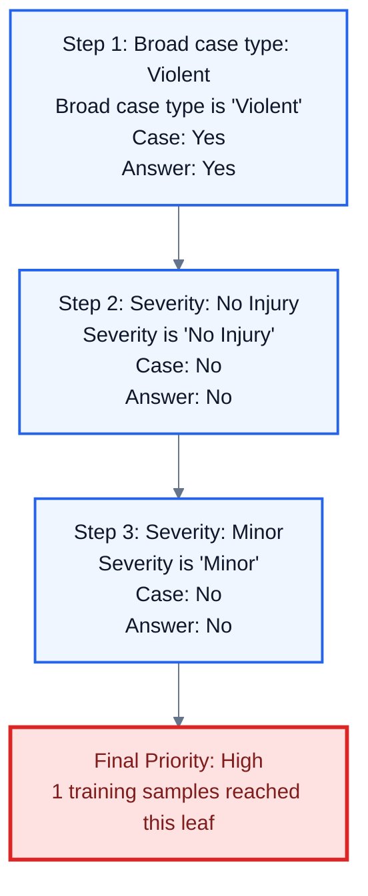

# Decision Tree Priority Report

  
High Priority

  <h2>ANV-2026-0051_whole_case</h2>
  
This case file brings together 4 documents (2 × Other, FIR, Police Report) and is assessed as a single matter of Criminal/Violent with fatal injury indicated, involving vulnerable parties. The evidence on record consists of “Exhibit_D01_Defence_Alibi_Murthal_Toll.pdf” (Other; General Civil; assessed Medium priority); “Exhibit_P01_FIR_214_2026_Connaught_Place.pdf” (FIR; Criminal/Violent; Fatal severity; assessed High priority); “Exhibit_P02_AIIMS_Trauma_Emergency_MLC.pdf” (Other; Criminal/Violent; Fatal severity; assessed High priority); “Exhibit_P03_Traffic_Police_Speed_Camera_Log.pdf” (Police Report; Property/Land; Major severity; assessed Medium priority). Cross-comparison finds 6 corroborating links between the documents (shared dates, places or parties), which strengthens the consistency of the record. For example, “Exhibit_D01_Defence_Alibi_Murthal_Toll.pdf” and “Exhibit_P01_FIR_214_2026_Connaught_Place.pdf” share places and parties.

  

    
Legal Category<strong>Criminal/Violent</strong>

    
Model Category<strong>Violent</strong>

    
Severity<strong>Fatal</strong>

    
Vulnerability<strong>High</strong>

    
Influence<strong>High</strong>

  

## Flow View

## Animated Step View

  
1

  

    
Step 1: Broad case type: Violent

    
Broad case type is 'Violent'

    
Case value: <strong>Yes</strong> | Result: <strong>Yes</strong>

  

  
2

  

    
Step 2: Severity: No Injury

    
Severity is 'No Injury'

    
Case value: <strong>No</strong> | Result: <strong>No</strong>

  

  
3

  

    
Step 3: Severity: Minor

    
Severity is 'Minor'

    
Case value: <strong>No</strong> | Result: <strong>No</strong>

  

  
4

  

    
Final Priority: High

    
The case reached this Decision Tree leaf.

    
Case value: <strong>1 training samples reached this leaf</strong> | Result: <strong>High</strong>

  

## Decision Trace

Node 0: Broad case type is 'Violent'; case value = Yes; result = Yes -> Node 28: Severity is 'No Injury'; case value = No; result = No -> Node 29: Severity is 'Minor'; case value = No; result = No -> Leaf node 30 => Predicted Priority = High

## Raw Graph

Raw DOT file: `case_priority_system/decision_graphs\ANV-2026-0051_whole_case_decision_path.dot`
