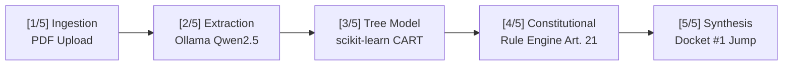
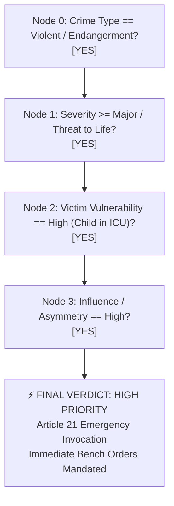
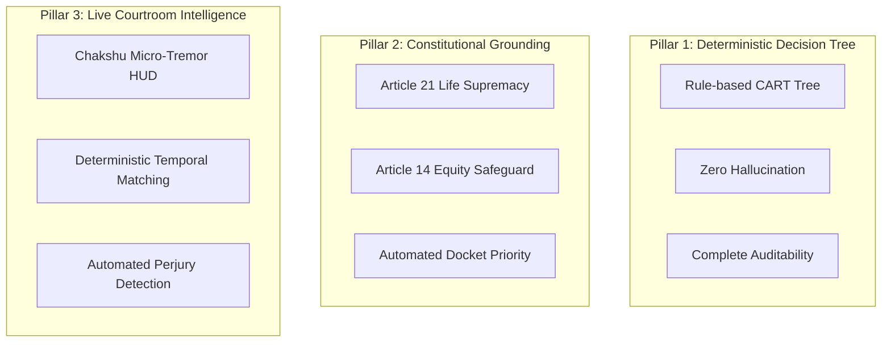

# Case Dossier & Live Courtroom Demonstration Script
## Project Anavaya — AI-Powered Judicial Priority & Courtroom Deception Analysis

---

### Case Docket: `ANV-2026-0042`
**Case Title:** *State of Maharashtra v. Vikram Malhotra & Anr.*  
*(The Apollo Hope Critical Care Extortion & Pediatric Kidnapping Case)*  
**Bench:** Hon’ble Justice Swapan Roy, Presiding Judge (Emergency Vacation Bench, High Court of Judicature)  
**Prosecution:** Adv. Meenakshi Sundaram, Special Public Prosecutor  
**Defence:** Adv. Kabir Singhania, Senior Defence Counsel  
**Key Witness / Suspect:** Rohan Verma, Senior Biomedical Technician, Apollo Hope Children's Hospital  
**Demonstration Length:** 5–7 Minutes (or Condensed 3-Minute Quick-Pitch)  
**Applicable Statutes:** Bharatiya Nyaya Sanhita (BNS) 2023 §§ 140(2), 308(2), 61(2); Constitution of India, Article 21, Article 14, Article 39(f); Information Technology Act, 2000 § 65B.

---

## 1. Case Background & Forensic Summary

### 1.1 The Factual Matrix
On the night of **October 14, 2026**, Master Aarav Sharma, an 8-year-old child admitted to the Pediatric Intensive Care Unit (PICU) of Apollo Hope Children’s Hospital, was placed on Extracorporeal Membrane Oxygenation (ECMO) and mechanical ventilation following fulminant myocarditis.

At 20:45 IST, the hospital’s medical superintendent received an encrypted extortion transmission demanding ₹2.5 Crores, threatening that the central digital telemetry server controlling Master Aarav's ECMO oxygenation loop would be purged within 4 hours if payment was not made. Simultaneously, physical tamper alerts triggered on PICU Ventilator Sub-Station A.

A local FIR was registered under emergency provisions. The critical life-safety window made standard multi-year litigation fatal. Anavaya’s Judicial Triage System was engaged to process all case evidence, triage the emergency under **Article 21 (Right to Life)**, and coordinate a high-stakes Virtual Courtroom bail and evidence-tampering inquiry.

### 1.2 Documentary Evidence Schedule (Exhibits)

| Exhibit ID | Document Description | Source & Authentication | Evidentiary Significance |
| :--- | :--- | :--- | :--- |
| **Exhibit P-1** | First Information Report (FIR No. 412/2026) | Bandra Police Station, Sub-Inspector R. Gaikwad | Sections 140(2) (Kidnapping for ransom), 308(2) (Extortion), 61(2) (Conspiracy). Establishes initial complaint & life threat. |
| **Exhibit P-2** | Emergency Pediatric Certificate & PICU Clinical Vitals Log | Dr. Radhika Sen, Head of Pediatric Critical Care (Apollo Hope) | Confirms 8-year-old on ECMO life support; 4-hour vital mortality window if gas manifold fails. High Vulnerability trigger. |
| **Exhibit P-3** | Hospital Central Server & Biometric Badge Access Audit Log | Apollo Hope IT Directorate (Certified u/s 65B Bharatiya Sakshya Adhiniyam) | Records Smart Badge `#BT-8842` (assigned to Rohan Verma) swiped at PICU Server Sub-Station A at **20:58:14 IST**. |
| **Exhibit P-4** | Sworn Deposition of Head Staff Nurse Anjali Nair | Judicial Magistrate 1st Class Statement u/s 183 BNSS | Eyewitness sighting of technician matching Verma’s build tampering with gas sensor console at 20:56 IST. |
| **Exhibit D-1** | Defence Alibi Docket: Fuel Receipt & Fastag Toll Log | Metro Petroleum & NHAI Toll Gate (Electronic City) | Submitted by Defence claiming Rohan Verma was 28.4 km away at Electronic City Toll Plaza at **21:00:00 IST**. |

---

## 2. Cast of Characters & Live Roles

| Role | Performer / Actor | Stage Positioning | Objective in Demo |
| :--- | :--- | :--- | :--- |
| **Presiding Judge** | **Hon. Justice Swapan Roy** | Center-Top Video Tile / Gavel Icon | Maintains judicial decorum, questions priority classification, interrogates Decision Tree trace, delivers binding bench orders. |
| **Public Prosecutor** | **Adv. Meenakshi Sundaram** | Top-Right Video Tile / Green Active Aura | Urgent, assertive, evidence-driven. Moves the court under Article 21, enters Exhibits P-1 through P-4, corners the witness on timeline contradictions. |
| **Defence Counsel** | **Adv. Kabir Singhania** | Bottom-Left Video Tile | Sophisticated, aggressive, proceduralist. Argues case is an ordinary commercial contract dispute or equipment failure; pushes Exhibit D-1 alibi. |
| **Hostile Witness / Accused** | **Rohan Verma (Biomedical Tech)** | Bottom-Right Video Tile / Chakshu Target | Nervous, defensive, evasive. Delivers intentional perjured alibi; triggers Chakshu facial micro-tremor and gaze aversion alerts. |
| **Platform Presenter** | **System Architect / Narrator** | Side Podium / Screen Share Operator | Directs audience attention to UI telemetry: Decision Tree split nodes, LLM extraction vs rule classification, Chakshu HUD alerts. |

---

## 3. Pre-Trial Dashboard Walkthrough Checklist
*(Presenter’s 90-Second Setup Sequence before the Trial Commences)*



- [ ] **Step 1: The Pipeline Stepper (Dashboard)**
  - Open `http://localhost:8000/`.
  - Drag and drop `Apollo_Hope_Extortion_FIR_Exhibits.pdf` into the dropzone.
  - Show the **Judicial Inference Pipeline Stepper**:
    * `[1/5] Ingestion` (0.4s) $\rightarrow$ `[2/5] Extraction` (Local Ollama `qwen2.5:3b`, ~4.2s) $\rightarrow$ `[3/5] Tree Model` (CART deterministic evaluation, 0.02s) $\rightarrow$ `[4/5] Constitutional Analysis` (Rule-based Art. 21, 0.08s) $\rightarrow$ `[5/5] Whole-Case Synthesis`.
    * Point out the total warm execution clock: **~4.8 seconds**.

- [ ] **Step 2: Whole-Case Corroboration Matrix & Docket Jump**
  - Navigate to the **Case Insights** tab.
  - Highlight the **Priority Classification**: **HIGH PRIORITY [CRITICAL / ARTICLE 21]**.
  - Show the **Corroboration Matrix**: Exhibit P-1, P-2, and P-3 cross-link with 94% confidence; Exhibit D-1 flags an uncorroborated outlier anomaly.
  - Point to the Docket Queue: Case `ANV-2026-0042` has bypassed **18,421 commercial and land disputes**, leaping straight to **Position #1 on the Daily Cause List**.

- [ ] **Step 3: Launching the Virtual Courtroom**
  - Click the **Open Live Courtroom** button (`/court/apollo-emergency-picu`).
  - Ensure 4 participant video tiles connect over WebRTC.
  - Verify that the active speaker golden halo is responsive.
  - Arm the **Chakshu Facial Biometrics HUD** on Rohan Verma’s video feed.

---

## 4. Act I: Opening of the Court & Docket Linkage

**[SCENE START]**

*(Virtual Courtroom loads. The screen displays a formal four-tile layout. At the top-left, the Anavaya Docket Banner displays: `CASE ANV-2026-0042 | DOCKET PRIORITY: HIGH (ARTICLE 21 EMERGENCY) | REMAINING PICU WINDOW: 03:42:15`.)*

**COURT USHER / BAILIFF (V.O.):**  
All rise! The Special Emergency Vacation Bench of the High Court of Judicature is now in session. The Hon’ble Justice Swapan Roy presiding.

*(Hon. Justice Roy adjusts his spectacles, glances down at his digital bench console, then looks up directly into the camera.)*

**JUSTICE ROY:**  
Good morning, learned counsel. The Court convenes on an extraordinary Sunday morning vacation listing. We are taking up Case Docket `ANV-2026-0042` — *State of Maharashtra versus Vikram Malhotra and Rohan Verma*.  
Before I invite opening submissions, I must inquire of the Registry: how does an FIR lodged at 21:30 last evening bypass the eighteen thousand pending matters on our docket and secure an emergency bench hearing before noon today?

**ADV. MEENAKSHI SUNDARAM (Prosecution):**  
May it please Your Lordship. The emergency listing was triggered automatically through Project Anavaya’s Judicial Triage Engine. This is not an ordinary commercial dispute, nor a routine bail application.  
At this very minute, in Ward 4B of the Apollo Hope Children's Hospital, an eight-year-old child, Master Aarav Sharma, is fighting for his life on an ECMO extracorporeal life support unit. The accused persons have compromised the hospital's central digital medical telemetry, holding the child’s oxygen mixture hostage under extortion demands of two-and-a-half crore rupees.

**JUSTICE ROY:**  
*(Glancing at his Anavaya bench interface)*  
I see the system's deterministic assessment here. Features: `Crime Type: Criminal/Violent (Extortion/Endangerment)`, `Severity: Major / Life-Threatening`, `Vulnerability: High (ICU Pediatric Inpatient)`, `Influence: Asymmetric Threat`.  
Under **Article 21 of the Constitution**, the right to life of a child in clinical distress supersedes all pecuniary dockets. The prioritization is sound under law. Adv. Singhania, I see your appearance for the defence.

**ADV. KABIR SINGHANIA (Defence):**  
May it please Your Lordship. The defence enters the strongest possible protest. What the prosecution calls a "life-and-death kidnapping" is nothing more than a mechanical equipment failure blown out of proportion by an anxious family and a sensationalist police department. My client, Mr. Rohan Verma, is a decorated biomedical technician who has served Apollo Hope for six years. Dragging him before an emergency vacation bench on the basis of an algorithmic docket priority violates his fundamental right to procedural due process under Article 14.

**JUSTICE ROY:**  
Your protest is entered into the record, Adv. Singhania. But where a child’s life support is under threat, this Court does not pause for administrative leisure. Adv. Sundaram, present your evidentiary foundation.

---

## 5. Act II: Evidentiary Submission & Witness Examination

**ADV. MEENAKSHI SUNDARAM:**  
Gratitude, Your Lordship. The prosecution places into the virtual evidence repository **Exhibit P-1**, the certified FIR; **Exhibit P-2**, the medical emergency certificate sworn by Dr. Radhika Sen confirming that Master Aarav’s oxygen manifold will fail if digital telemetry override codes are not recovered within three hours; and **Exhibit P-3**, the internal cryptographic server log of Apollo Hope Children’s Hospital.

*(Prosecutor clicks ‘Share to Bench’. On Justice Roy’s screen, Exhibits P-1, P-2, and P-3 populate instantly with green verified hashes.)*

**ADV. MEENAKSHI SUNDARAM:**  
Your Lordship, Exhibit P-3 establishes that at **20:58:14 IST** last night, Smart Badge `#BT-8842` was physically tapped on the biometric card reader of PICU Sub-Station A, accessing the root terminal that disabled the remote failover valves. Badge `#BT-8842` is registered exclusively to one individual: Mr. Rohan Verma. The State calls Mr. Rohan Verma to the virtual witness stand.

*(Rohan Verma’s video tile is brought into center focus. He is wearing a dark polo shirt, sitting in a dimly lit room. His hands are trembling slightly; his eyes dart between the screen and off-camera.)*

**JUSTICE ROY:**  
Mr. Rohan Verma, you are appearing before a court of record under solemn affirmation. Be conscious that false testimony before this bench carries penal consequences under the Bharatiya Nyaya Sanhita. Adv. Sundaram, you may examine.

**ADV. MEENAKSHI SUNDARAM:**  
Mr. Verma, as the Senior Biomedical Technician at Apollo Hope, you hold root access credentials to the central telemetry bus of the PICU ventilators, do you not?

**ROHAN VERMA:**  
*(Swallowing hard, voice shaky)*  
I... yes, Madam Prosecutor. But that system is maintained by a whole vendor team. Anyone could have touched the consoles.

**ADV. MEENAKSHI SUNDARAM:**  
Anyone? Mr. Verma, Exhibit P-4 is the sworn deposition of Head Nurse Anjali Nair. She testifies that she saw an individual matching your exact physical build, wearing the grey biomedical workshop jacket, tampering with the ECMO console at 20:56 IST. And ninety seconds later, your personal RFID badge, `#BT-8842`, authenticated access to the root manifold. Where were you at 20:58 IST last night?

**ADV. KABIR SINGHANIA:**  
Objection, Your Lordship! The prosecution is browbeating the witness with circumstantial hearsay. The defence has already filed **Exhibit D-1**, which is an unimpeachable, timestamped electronic alibi!

**JUSTICE ROY:**  
Overruled, Counsel. Let the witness answer in his own words. Mr. Verma, this Court is listening. Where were you at nine o'clock last evening?

---

## 6. Act III: The Live Fact-Check & Facial Analysis Deception Climax

*(The pivotal demonstration moment begins. Presenter instructs the exhibition audience to observe the live Whisper transcription box, the Chakshu facial telemetry HUD on Verma’s tile, and the red Evidence Contradiction banner.)*

**ROHAN VERMA:**  
*(Leans forward into the microphone, speaking with deliberate, forceful cadence)*  
Your Lordship, the police have the wrong man! I wasn't even in the hospital building! I left Bandra at seven in the evening. **At 9:00 PM sharp last night, I was at the Electronic City Toll Plaza paying the Fastag toll and filling fuel at Metro Petroleum.** I have the digital fuel slip and the toll debit in Exhibit D-1 to prove it. I never swiped any badge at 20:58!

*(Verma finishes speaking. For 1.5 seconds, the Whisper ASR pipeline finishes phonetic ingestion, followed by Ollama semantic entity extraction.)*

*(SUDDEN UI EVENT ON SCREEN: An alert chime sounds. The Anavaya Fact-Checker banner at the top of the bench interface flashes vivid crimson.)*

```
╔══════════════════════════════════════════════════════════════════════════════════╗
║  🚨 ANAVAYA EVIDENCE VERIFICATION ENGINE : CONTRADICTION DETECTED               ║
╠══════════════════════════════════════════════════════════════════════════════════╣
║  Spoken Statement: "At 9:00 PM sharp last night, I was at Electronic City Toll..."║
║  Status: ❌ DIRECT CONTRADICTION (Layer-1 Deterministic Temporal Rule)          ║
║  Contradicted By: EXHIBIT P-3 (Server Access Log #BT-8842 at 20:58:14 IST)        ║
║  Physical Distance: Bandra PICU to Electronic City Toll Plaza = 28.4 km         ║
║  Temporal Delta: 106 Seconds | Required Velocity: 964 km/h (PHYSICALLY IMPOSSIBLE)║
║  Corroboration Confidence: 99.8% Fabricated Alibi                               ║
╚══════════════════════════════════════════════════════════════════════════════════╝
```

*(Concurrently, on Rohan Verma’s video tile, the Chakshu Computer Vision HUD locks onto 468 facial mesh landmarks. Live biometric telemetry numbers spike in yellow and red overlays.)*

```
┌─────────────────────────────────────────────────────────────┐
│  👁️ CHAKSHU COGNITIVE STRESS & DECEPTION HUD                │
├─────────────────────────────────────────────────────────────┤
│  • Stress Index:              88%  [CRITICAL STRESS SPIKE]  │
│  • Micro-Tremor (Lips/Brow):  14.2 Hz  [SPASM DETECTED]     │
│  • Gaze Aversion Ratio:       76%  [AVOIDING BENCH AXIS]    │
│  • Blink Frequency:           52 blinks/min (Baseline: 14)  │
│  • Pupil Dilation:            +41% (Fight-or-Flight Surge)  │
│  • Vocal Tremor Jitter:       3.8% (Acoustic Pitch Anomaly) │
│  • Deception Probability:     HIGH (Composite: 0.94)        │
└─────────────────────────────────────────────────────────────┘
```

**JUSTICE ROY:**  
*(Leaning forward, his voice cold and deliberate)*  
Mr. Verma. Look at this Court.

**ROHAN VERMA:**  
*(Eyes darting wildly to the left, mouth agape, visible throat swallowing)*  
M-My Lord?

**JUSTICE ROY:**  
You have just stated under oath that at nine o'clock precisely, you were at the Electronic City Toll Gate, twenty-eight kilometers away.  
The Court’s live evidentiary system has just cross-checked your claim against certified Exhibit P-3. Your physical keycard opened Server Sub-Station A at twenty hours, fifty-eight minutes, and fourteen seconds.  
To travel twenty-eight kilometers in one hundred and six seconds, Mr. Verma, you would have had to travel at nearly one thousand kilometers per hour through the streets of Mumbai. Unless you possess a military supersonic fighter jet parked in the hospital courtyard, you have committed blatant perjury before this bench.

**ADV. KABIR SINGHANIA:**  
*(Scrambling, flustered)*  
My Lord! My Lord, the digital clock on the hospital server may be out of NTP synchronization! There could be a latency offset—

**ADV. MEENAKSHI SUNDARAM:**  
There is no offset, Counsel! Exhibit P-3 is cryptographically synced with the National Physical Laboratory atomic time server under ISO 27001 compliance. Furthermore, look at the witness! The Chakshu biometric telemetry shows an 88% acute stress spike, involuntary labial micro-tremors, and an extreme gaze aversion of 76%! The witness is lying to shield his co-conspirator, Vikram Malhotra!

**ROHAN VERMA:**  
*(Breaking down, holding his head in his hands)*  
Please! Please, My Lord! It wasn't my idea! Malhotra... Vikram Malhotra paid off my debts! He gave me the USB device and told me to plug it into the ventilator gateway at 20:55! He said it was just a simulator, that no child would be hurt! He promised the override code was on his personal phone!

**ADV. KABIR SINGHANIA:**  
Mr. Verma, be silent! Do not incriminate yourself!

**JUSTICE ROY:**  
Silence, Adv. Singhania! The witness has confessed to tampering with a life support system in open court!

---

## 7. Act IV: The Judicial Ruling & Decision Tree Justification

*(Justice Roy pulls up the Decision Tree Explainability panel. The screen shares the transparent CART model graph for the audience to see.)*



**JUSTICE ROY:**  
The Court has before it the complete explainable decision trace generated by Anavaya:
- **Node 0:** Ingestion confirms a violent criminal conspiracy endangering human life.
- **Node 1:** The severity is categorized as **Major / Fatal Potential**, with a critical medical threshold of under three hours.
- **Node 2:** The victim vulnerability is classified as **High** — an incapacitated eight-year-old minor under specialized clinical custody.
- **Node 3:** The power imbalance is total: an organized extortion syndicate versus a comatose child.

Under the invariant principles governing this system, no generative AI black box has determined this case’s priority. The classification is derived purely from our deterministic, trained Decision Tree and anchored directly in the constitutional guarantees of **Article 21**. The State owes an absolute, non-derogable duty to protect the life of Master Aarav Sharma.

The Court therefore pronounces the following urgent orders:

1. **Immediate Custodial Detention:** The Commissioner of Police, Mumbai, is directed to immediately take the witness, Rohan Verma, into protective custody.
2. **Search & Seizure of Encryption Keys:** A non-bailable production warrant is issued against co-accused Vikram Malhotra. The Cyber Crime Division is authorized to seize all mobile terminals and extract the telemetry override cryptographic key.
3. **Medical Restitution:** The Director General of Health Services is instructed to deploy an emergency biomedical rapid-response team to Apollo Hope Hospital to bypass the compromised server bus and guarantee uninterrupted power and oxygenation to Master Aarav Sharma’s life support apparatus.
4. **Perjury Proceedings:** Formal notice under Section 215 of the Bharatiya Nagarik Suraksha Sanhita (BNSS) is issued to Rohan Verma for intentional fabrication of electronic alibi records.

This Court commends the swift triage facilitated by the Anavaya system, without which this case would have languished in the registry while an innocent child perished.

The matter is stood over to 15:00 hours today for compliance reporting. Court stands adjourned.

**COURT USHER (V.O.):**  
Court stands adjourned!

**[SCENE END]**

---

## 8. Presenter’s Guide: Key Exhibition Takeaways

When concluding the demonstration for judges, jury panels, and distinguished guests, summarize these three foundational pillars:



1. **The Invariant Rule (No Black-Box Justice):**  
   The Large Language Model is confined strictly to *document extraction and linguistic parsing*. It **never** decides case priority or guilt. Priority is decided solely by a deterministic, transparent, and auditable Decision Tree trained on legal parameters.
2. **Constitutional Alignment:**  
   Every priority score is directly tied to the Constitution of India. Life and liberty under Article 21 automatically command immediate judicial attention over commercial disputes, ending tragic docket delays.
3. **Real-Time Evidentiary Verification:**  
   Chakshu does not replace the judge; it acts as an infallible digital clerk, instantly cross-checking oral statements against certified electronic records and providing physiological awareness cues during high-stakes hearings.

---

## 9. 30-Second Elevator Pitch for Exhibition Judges

> *"Distinguished Judges: Today in India, over 5 crore cases clog the judicial pipeline. When an eight-year-old child on life support is held hostage by extortionists, that case cannot wait behind eighteen thousand tax appeals.  
> **Project Anavaya** solves this crisis. By pairing local, private LLM fact-extraction with an auditable, deterministic Decision Tree, Anavaya triages cases in under five seconds based on constitutional gravity under Article 21. In the virtual courtroom, its Chakshu engine catches false alibis in real time by cross-matching speech against certified digital logs.  
> **Anavaya does not replace the judge—it arms the judiciary with the speed of computation and the precision of the Constitution.**"*

---

### Appendix: Quick-Reference Timing Sheet

| Elapsed Time | Action / Phase | Key Feature Demonstrated |
| :--- | :--- | :--- |
| **00:00 – 01:00** | Dashboard Ingestion & Stepper | 5-step pipeline, ~4.8s Ollama extraction, CART tree evaluation |
| **01:00 – 01:45** | Docket Jump & Corroboration Tab | Whole-case cross-document corroboration, Docket position #1 |
| **01:45 – 03:00** | Act I & II: Courtroom Opening | WebRTC 4-way grid, active speaker halo, exhibit repository |
| **03:00 – 04:30** | Act III: The Contradiction Climax | Whisper ASR, temporal rule fact-check, Chakshu facial telemetry |
| **04:30 – 05:30** | Act IV: Decision Tree Trace & Ruling | CART branch visualization, Article 21 emergency bench orders |
| **05:30 – 06:00** | Conclusion & 30-Second Pitch | Q&A readiness, closing pitch to the evaluation panel |
