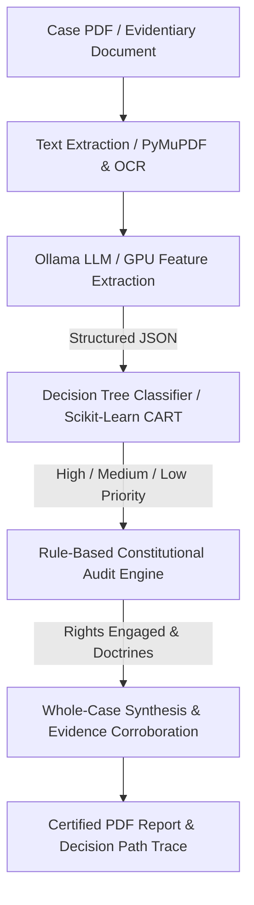

# Anavaya — Judicial Intelligence System Architecture

## 1. High-Level Pipeline Architecture

Anavaya operates on a strict **hybrid LLM + Decision Tree + Constitutional Rule Engine** architecture:

## 2. Invariant Contract
* **The LLM never assigns priority.** It parses and extracts factual entities only.
* **The CART Decision Tree alone decides priority.** Priority classification is 100% deterministic, auditable, and reproducible.
* **Constitutional analysis is rule-based.** Articles 14, 21, 19, 23, 265, and 300A are grounded in codified statutory doctrines.

## 3. Data Dictionary
| Dimension | Allowed Values | Signal Weight |
| :--- | :--- | :--- |
| `crime_type` | Violent, Financial, Property, Non-Violent | Primary |
| `severity` | Fatal, Major, Minor, No Injury | Primary |
| `vulnerability` | High, Medium, Low | Secondary |
| `influence` | High, Low | Tertiary |
| `case_category` | Excise/Tax, Customs, Company, Insolvency, Writ, Property, Criminal, Civil | Categorical |
